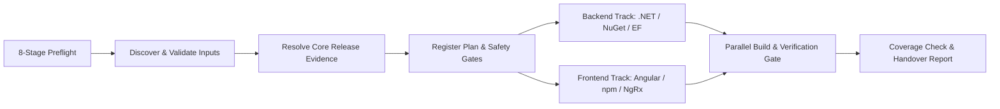

# NGO Core Upgrade

Upgrade a client's **NGO.Core (.NET backend) packages and Angular frontend** through VS Code GitHub Copilot Chat, the deterministic CLI engine, or the local Web UI platform—with a verified preflight check, a registered upgrade plan, and a unified verification report.

---

## 🚀 Start Here — Main Upgrade Flow (4 Steps)

If your machine is already set up (if not, see [First-Time Machine Setup](#-first-time-machine-setup-guide-5-steps) below), follow these **4 steps** every time you upgrade a client:

### 1. Set Your Project Paths
Make sure your client and Core paths are configured in:
- **[`ngo-core-upgrade.code-workspace`](ngo-core-upgrade.code-workspace)** — Replace `"../PATH/TO/YOUR/CLIENT/SOLUTION"` with your client path (e.g. `"C:/repos/ngo-online-shelterbox"`) and open the workspace in VS Code (**File -> Open Workspace from File...**).
- **[`platform/config/settings.json`](platform/config/settings.json)** — Set `"approvedWorkspaceRoots"` (e.g. `["C:\\repos"]`) and `"corePath"` (e.g. `"C:\\repos\\ngo-online-core"`).

### 2. Run the Preflight Check
In a terminal at the root of `NGO Core Upgrade`, verify your paths, Git tags, NuGet feeds, and `.npmrc` before starting the agent:
```powershell
node tools/check-environment.js `
  --core-path "C:\repos\ngo-online-core" `
  --client-path "C:\repos\ngo-online-shelterbox" `
  --target 9.4.1
```
Confirm the output says **`Readiness Status: READY TO UPGRADE`**.

### 3. Select the Agent in VS Code Copilot Chat
Open Copilot Chat, click the agent dropdown next to the **`+`** icon, and select **`ngo-core-upgrade-orchestrator`**:

| Agent Name in Dropdown | When to Select It |
| --- | --- |
| ✅ **`ngo-core-upgrade-orchestrator`** | **(Recommended Default)** Use for full-stack upgrades (Backend + Frontend), release checks, or end-to-end execution. |
| **`ngo-core-backend-upgrade`** | Use only when running backend-only (`.NET / NuGet / EF / appsettings.json`) tasks directly. |
| **`ngo-core-frontend-upgrade`** | Use only when running frontend-only (`Angular / TypeScript / npm`) tasks directly. |

### 4. Send Your Upgrade Prompt (Copy & Paste Samples)
Paste all 3 inputs (`Core path`, `Client path`, `Target version`) in your prompt so **`ngo-core-upgrade-orchestrator`** starts immediately without pausing to ask:

```text
Upgrade my client project to NGO Core 9.4.1:
- Core path: C:\repos\ngo-online-core
- Client path: C:\repos\ngo-online-shelterbox
- Target version: 9.4.1
```

#### More Prompt Samples for `ngo-core-upgrade-orchestrator`

| Goal | Copy-Paste Prompt Sample |
| --- | --- |
| **Latest Release on a Branch (e.g. latest `9.4.x`)** | `Upgrade my client project to the latest 9.4 release:`<br>`- Core path: C:\repos\ngo-online-core`<br>`- Client path: C:\repos\ngo-online-shelterbox`<br>`- Target version: 9.4` |
| **Backend Only (`.NET / NuGet`)** | `Upgrade only the backend NGO.Core packages:`<br>`- Core path: C:\repos\ngo-online-core`<br>`- Client path: C:\repos\ngo-online-shelterbox`<br>`- Target version: 9.4.1` |
| **Frontend Only (`Angular / npm`)** | `Align only the frontend with NGO Core 9.4.1:`<br>`- Core path: C:\repos\ngo-online-core`<br>`- Client path: C:\repos\ngo-online-shelterbox`<br>`- Target version: 9.4.1` |
| **Resume a Saved Run** | `Resume the upgrade for ngo-online-shelterbox using its saved run state.` |

> **Prefer a Browser Dashboard instead of Chat?**
> Run `node platform/start.js` and open **`http://127.0.0.1:3800/`** to configure paths, run preflight previews, and launch upgrades visually. See [platform/README.md](platform/README.md).

---

## 📍 Where to Add & Check All Paths in Detail

There are **4 places** where paths are configured or checked. Setting these up once on your machine prevents path-discovery issues:

### 1. VS Code Workspace File ([`ngo-core-upgrade.code-workspace`](ngo-core-upgrade.code-workspace))
Opens both this agent repo and your client repo in one VS Code window so Copilot can read and edit client files:

```json
{
  "folders": [
    {
      "name": "NGO Core Upgrade Agent",
      "path": "."
    },
    {
      "name": "Client Solution",
      "path": "C:/repos/ngo-online-shelterbox"
    },
    {
      "name": "NGO Online Core (Read-Only)",
      "path": "C:/repos/ngo-online-core"
    }
  ],
  "settings": {
    "chat.useCustomizationsInParentRepositories": true
  }
}
```

### 2. Platform & Auto-Discovery Config ([`platform/config/settings.json`](platform/config/settings.json))
By default in the repository, [`platform/config/settings.json`](platform/config/settings.json) points to `"D:\\NGO Client"`. Update lines 2–5 to match your machine:

```json
{
  "approvedWorkspaceRoots": [
    "C:\\repos"
  ],
  "corePath": "C:\\repos\\ngo-online-core",
```

### 3. User Environment Variables (Optional Machine-Wide Fallback)
Run once in PowerShell so `check-environment.js` and `core-discovery.js` always find your repositories automatically:

```powershell
[Environment]::SetEnvironmentVariable("NGO_CORE_PATH", "C:\repos\ngo-online-core", "User")
[Environment]::SetEnvironmentVariable("NGO_WORKSPACE_ROOTS", "C:\repos", "User")
```
*(Restart VS Code / terminal after setting environment variables.)*

### 4. Package Manager Config Files (`NuGet.Config` & `.npmrc`)
- **NuGet (`.NET` Backend):**
  - Project config: `<client-path>\ngo-api\NuGet.Config` or `<client-path>\NuGet.Config`
  - User config: `%APPDATA%\NuGet\NuGet.Config` (`C:\Users\<you>\AppData\Roaming\NuGet\NuGet.Config`)
- **npm (`Angular` Frontend):**
  - Project config: `<client-path>\ngo-client\.npmrc` (registry URLs only—no hardcoded personal tokens)
  - User config: `%USERPROFILE%\.npmrc` (`C:\Users\<you>\.npmrc`—stores your personal auth tokens)

---

## 🛠️ First-Time Machine Setup Guide (5 Steps)

Complete these 5 steps once when setting up a new developer workstation:

### Step 1 — Install Required Runtimes & Tools

The preflight checker verifies only the tools required for your active tracks (`backend`, `frontend`, or `backend,frontend`):

| Tool | Required When | Minimum Version | Windows Install Command (`winget`) |
| --- | --- | --- | --- |
| **Git** (`git`) | Always | `>= 2.20` | `winget install --id Git.Git -e --source winget` |
| **Node.js** (`node`) | Always | `>= 14.x` (`18+` LTS recommended) | `winget install OpenJS.NodeJS.LTS` |
| **GitHub CLI** (`gh`) | Optional (Recommended) | `>= 2.0` | `winget install --id GitHub.cli -e --source winget` |
| **.NET SDK** (`dotnet`) | `backend` track active | Matches client `<TargetFramework>` (`.NET 6` / `8` / `9`) | `winget install Microsoft.DotNet.SDK.8` |
| **EF Core CLI** (`dotnet-ef`) | Optional (EF migration checks) | Matches `.NET SDK` | `dotnet tool install --global dotnet-ef` |
| **Azure CLI** (`az`) | Optional (Azure Artifacts auth fallback) | `>= 2.0` | `winget install Microsoft.AzureCLI` |
| **npm CLI** (`npm`) | `frontend` track active | `>= 6.x` (`9+` recommended) | Bundled with Node.js LTS |

---

### Step 2 — Configure Git Identity & GitHub Authentication

Logging into `gh` alone does **not** automatically configure `git fetch` / `git ls-remote` over HTTPS unless `gh auth setup-git` is run. Run all 4 commands in PowerShell:

```powershell
# 1. Configure your Git author identity (used for upgrade commits)
git config --global user.name "Your Full Name"
git config --global user.email "your.email@organization.com"

# 2. Log in to GitHub CLI interactively (never paste PATs into chat)
gh auth login --hostname github.com --web

# 3. Link GitHub CLI as Git's HTTPS credential helper
gh auth setup-git --hostname github.com

# 4. Verify login status
gh auth status
```

- **If your repos use SSH remotes (`git@github.com:...`)**: ensure your SSH key is loaded (`ssh-add`) and uploaded to GitHub (`gh ssh-key add`).
- **If your organization requires SAML SSO**: run `gh auth refresh -h github.com -s read:org,repo` and authorize SSO in the browser.

---

### Step 3 — Clone & Fetch `ngo-online-core` (Strictly Read-Only)

The agent reads tags (`v<version>`), release branches (`releases/*`), and commits from a local `ngo-online-core` checkout. **Core is strictly READ-ONLY**—the agent never checks out branches or modifies files in `ngo-online-core`.

```powershell
# Clone ngo-online-core if you don't have it yet
git clone https://github.com/<your-org>/ngo-online-core.git C:\repos\ngo-online-core

# Always fetch all tags and release branches before upgrading
cd C:\repos\ngo-online-core
git fetch --all --tags
```

---

### Step 4 — Authenticate NuGet & Azure Artifacts (.NET Backend Track)

NGO Core backend packages (`NGO.Core`, `NGO.Core.API`, etc.) are hosted on a private Azure Artifacts NuGet feed. Public `nuget.org` access is **not** sufficient.

1. **Install the Azure Artifacts Credential Provider** (if not already installed with Visual Studio):
   ```powershell
   iex "& { $(irm https://aka.ms/install-artifacts-credprovider.ps1) } -AddNetfx"
   ```
2. **Authenticate interactively once** inside your client's backend folder (`ngo-api/`):
   ```powershell
   cd "C:\repos\ngo-online-shelterbox\ngo-api"
   dotnet restore --interactive
   ```
   *(Alternatively, sign in via `az login`, or set `$env:AZURE_DEVOPS_EXT_PAT = "<your-pat>"` in your user environment).*
3. **Check `<packageSourceMapping>` (if present in your `NuGet.Config`):**
   If your `NuGet.Config` uses `<packageSourceMapping>`, ensure your NGO private feed includes `<package pattern="NGO.*" />`.

---

### Step 5 — Authenticate npm & `.npmrc` (Angular Frontend Track)

Client frontend projects (`<client-path>\ngo-client\`) consume scoped packages from private registries (`@ngo:registry=...`, `@fortawesome:registry=...`).

1. **Authenticate your user `%USERPROFILE%\.npmrc`:**
   ```powershell
   # For Azure Artifacts npm feeds on Windows:
   cd "C:\repos\ngo-online-shelterbox\ngo-client"
   npx vsts-npm-auth -config .npmrc

   # Or for standard npm v9+ web login:
   npm login --auth-type=web --registry=<registry-url>
   ```
2. **Safe, Non-Destructive Install Behavior:**
   - The upgrade agent **never** overwrites your `.npmrc` with hardcoded tokens and **never** runs `npm i -f --peer-deps`.
   - It uses `npm ci --legacy-peer-deps` when `package-lock.json` is valid and unchanged, or `npm install --legacy-peer-deps` when `package.json` dependencies are updated.

---

## 🔍 8-Stage Preflight Reference (`tools/check-environment.js`)

```powershell
node tools/check-environment.js `
  --core-path "C:\repos\ngo-online-core" `
  --client-path "C:\repos\ngo-online-shelterbox" `
  --target 9.4.1 `
  --tracks backend,frontend
```

| CLI Flag | Description |
| --- | --- |
| `--core-path <path>` | Path to local `ngo-online-core` repository (optional if `NGO_CORE_PATH` or `settings.json` is configured). |
| `--client-path <path>` | Path to the target client repository root. |
| `--target <version>` | Target Core version or branch (e.g. `9.4`, `9.4.1`, `releases/9.4`). Branch targets like `9.4` automatically resolve to the latest verified release on that branch (e.g. `9.4.1`), never defaulting blindly to `.0`. |
| `--tracks <list>` | Comma-separated tracks: `backend,frontend` (default), `backend`, or `frontend`. |
| `--json` | Output structured JSON report including all 8 stages and the `stateFingerprint`. |

### What the 8 Stages Verify
1. **Stage 1 — Runtime & Tool Availability:** Checks `git`, `node`, `gh`, `dotnet` (verifying SDK compatibility with the client's `<TargetFramework>`), `dotnet-ef`, `az`, and `npm` (scoped to active tracks).
2. **Stage 2 — Git Identity & GitHub Remote Access:** Verifies `git config user.name` / `user.email`, `gh auth status`, `credential.helper`, and `git ls-remote`.
3. **Stage 3 — Local NGO Core Repository Discovery & Validation:** Validates Core `.git` root boundaries, remote URL, and project structure (`ngo-api-core/`, `ngo-client-core/`), and rejects client repositories.
4. **Stage 4 — NuGet & Azure Artifacts 5-Stage Check:** Separates (1) `NuGet.Config` & `<packageSourceMapping>` validity, (2) Credential Provider discovery, (3) auth token acquisition, (4) private feed HTTP probe (`200` vs `401` vs `403`), and (5) target package version availability.
5. **Stage 5 — npm & `.npmrc` Configuration:** Inspects `<client>\ngo-client\.npmrc` and `%USERPROFILE%\.npmrc` (with secrets redacted), checks private scoped registries for valid credentials, and selects `npm ci --legacy-peer-deps` vs `npm install --legacy-peer-deps`.
6. **Stage 6 — Target Client Project & Working Tree Safety:** Detects installed backend (`.csproj`) and frontend (`package.json`) Core versions and checks `git status --porcelain`.
7. **Stage 7 — Release Resolution Preconditions:** Verifies source and target release evidence (tags `v<version>`, `releases/*` branches, or published package artifacts).
8. **Stage 8 — Readiness Verdict & Exact Command:** Outputs `READY TO UPGRADE` (or `BLOCKED` with exact fix commands) and prints the ready-to-run `upgrade-engine.js` command.

---

## 🔧 Troubleshooting Common Path & Auth Errors

| Error / Status | Cause | Exact Fix |
| --- | --- | --- |
| Agent asks for paths or cannot find `ngo-online-core` | Paths were not passed in the prompt and [`platform/config/settings.json`](platform/config/settings.json) still has `"D:\\NGO Client"`. | Update `corePath` and `approvedWorkspaceRoots` in [`platform/config/settings.json`](platform/config/settings.json), and include `Core path:` and `Client path:` in your prompt. |
| `GH_AUTH_OK_BUT_GIT_CREDENTIAL_MISSING` | `gh auth status` is logged in, but Git's `credential.helper` is not linked. | Run: `gh auth setup-git --hostname github.com` |
| `SSH_AUTH_FAILED` | Repository `origin` uses `git@github.com:...` (SSH), and `gh auth login` over HTTPS does not configure SSH keys. | Load your SSH key (`ssh-add`) or upload it via `gh ssh-key add`, or use HTTPS with `gh auth setup-git`. |
| `MULTIPLE_CANDIDATES_FOUND` | More than one valid `ngo-online-core` folder exists under your workspace roots. | Pass `--core-path "<chosen-path>"` explicitly or set `NGO_CORE_PATH`. |
| `SOURCE_MAPPING_BLOCKED` | `NuGet.Config` has `<packageSourceMapping>` without an `NGO.*` pattern. | Add `<packageSource key="<YourNGOFeed>"><package pattern="NGO.*" /></packageSource>` to `NuGet.Config`. |
| `UNAUTHENTICATED` (`HTTP 401` on NuGet) | Missing or expired Azure Artifacts token. | Run `dotnet restore --interactive` inside `<client>\ngo-api\` or run `az login`. |
| `FORBIDDEN` (`HTTP 403` on NuGet) | Logged-in Azure account lacks Reader permission on the feed. | Request **Feed Reader** access in Azure DevOps -> Artifacts -> Feed Settings -> Permissions (do not retry login). |
| `NPM_AUTH_REQUIRED` / `INCOMPLETE_VSS_OR_BASIC_AUTH` | `<client>\ngo-client\.npmrc` has a private registry or `username=VssSessionToken` without a token in `%USERPROFILE%\.npmrc`. | Run `npx vsts-npm-auth -config .npmrc` inside `<client>\ngo-client\` or add your token to `%USERPROFILE%\.npmrc`. |
| `MISSING_ENV_VAR_IN_NPMRC` | `.npmrc` references `${VAR_NAME}`, which is not defined in the current shell environment. | Set `$env:VAR_NAME = "<token>"` in your user environment before running `npm`. |

---

## ⚙️ Architecture, Release Discovery & Outputs



### Release Discovery Hierarchy & Urgent Package-First Mode
1. **Published package artifact:** matching the requested target version (NuGet `.nupkg` / npm package).
2. **Official release tag or immutable source revision:** if available in Git (`v<version>`).
3. **Official release metadata and release notes:** if provided.
4. **Relevant commits, pull requests, or source diffs:** if available (`releases/*` branches).
5. **Authoritative package metadata:** and compatibility information.

> **Urgent Package-First Releases:** A `releases/*` branch is an optional discovery hint, never a prerequisite. When packages are published before a release branch or tag is created, the agent proceeds in **Package-First Mode** without blocking on absent Git branches.

### Where Results Go

| Output | Location |
| --- | --- |
| Combined report and deployment handover | `orchestrator/runs/<client>/<run-id>/` |
| Backend state, checkpoints, and evidence | `backend/runs/<client>/<run-id>/` |
| Frontend state, checkpoints, and evidence | `frontend/runs/<client>/<run-id>/` |
| Reusable Core candidate facts | `ingest/knowledge/candidates/releases/` |
| Shared `core-change-set.json` & `upgrade-context.json` | `orchestrator/runs/<client>/<run-id>/` |

---

## 📦 Install or Package for Another Machine

**Install into VS Code user profile from a Git repository:**
```powershell
# Windows
.\install.ps1 -RepoUrl https://github.com/<your-org>/NGO-Core-Upgrade.git

# Or from an existing local folder
.\install.ps1 -InstallDir "C:\repos\NGO-Core-Upgrade" -SkillsOnly
```

**Create a clean, portable `.zip` archive to share with coworkers:**
```powershell
.\package-agent.ps1 -OutputPath ".\dist"
```
`package-agent.ps1` strips machine-specific paths (`D:\NGO Client`), local run histories, and credential files so the zip is clean for any coworker's machine. See [IMPORT.md](IMPORT.md).

---

<a id="tests--validation"></a>

## 🧪 Tests & Framework Validation

Run from this repository's root:

```powershell
node tools/validate-all.js
```

This runs all **20 validation suites** and verifies that no tracked files were modified during testing. Add `--verbose` for per-suite output.

<details>
<summary>Individual suites for targeted troubleshooting</summary>

```powershell
# Cross-machine portability, auth, discovery, NuGet & npm (16 scenarios)
node platform/tests/cross-machine-portability.test.js

# NuGet sources & Azure Artifacts 5-stage preflight
node platform/tests/nuget-sources.test.js

# Preflight truthfulness & safety audit
node platform/tests/preflight-audit.test.js

# Platform UI & API contract
node platform/tests/platform.test.js

# Shared Engine & Release Resolution Matrix
node engine/tests/engine.test.js
node engine/tests/release-resolution-matrix.test.js
```

</details>

---

## 📚 Developer Reference

| Area | Documentation |
| --- | --- |
| Routing, multi-machine protocol, and safety contract | [AGENTS.md](AGENTS.md) |
| Shared engine lifecycle and contracts | [engine/AGENTS.md](engine/AGENTS.md) |
| Shared release ingestion | [ingest/README.md](ingest/README.md) |
| Shared-run coordination | [orchestrator/README.md](orchestrator/README.md) |
| Backend executor workflow | [backend/README.md](backend/README.md) |
| Frontend executor workflow | [frontend/README.md](frontend/README.md) |
| Local Web UI platform | [platform/README.md](platform/README.md) |
| Portable packaging & import guide | [IMPORT.md](IMPORT.md) |
