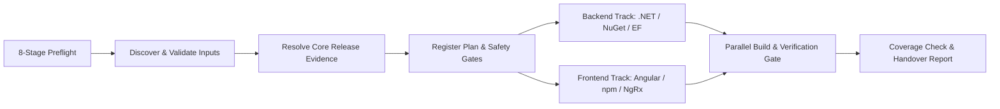

# NGO Core Upgrade

Upgrade a client's **NGO.Core (.NET backend) packages and Angular frontend** through your AI coding assistant (GitHub Copilot / Antigravity), the deterministic CLI engine, or the local Web UI platform—with a verified preflight check, a registered upgrade plan, and a unified verification report.

---

## 🚀 Quick Start (3 Ways to Use the Agent)

### Option A — AI Coding Assistant (Copilot Chat / Antigravity)
1. **Open the workspace.** Open this repository (or a workspace containing both this folder and your target client repository, using [ngo-core-upgrade.code-workspace](ngo-core-upgrade.code-workspace) as a template).
2. **Select the agent.** Open Chat and select **`@ngo-core-upgrade`** (or invoke the workspace agent directly).
3. **Send your upgrade request:**
   ```text
   Upgrade this client from Core 9.2 to 9.4.1.
   ```
   If you haven't specified local paths in your prompt, the agent will ask once for:
   - Your local `ngo-online-core` repository path (or discover it automatically if `NGO_CORE_PATH` / `NGO_WORKSPACE_ROOTS` is configured).
   - Your local client repository path.
   - Your target Core version or branch (e.g. `9.4` or `9.4.1`).

### Option B — Deterministic CLI Preflight & Engine
Run the 8-stage environment preflight check first to verify your tools, Git/GitHub access, local Core checkout, NuGet/Azure Artifacts feed auth, and `.npmrc` readiness:
```powershell
node tools/check-environment.js `
  --core-path "C:\repos\ngo-online-core" `
  --client-path "C:\repos\ngo-online-shelterbox" `
  --target 9.4.1
```
When preflight reports **`READY TO UPGRADE`**, it prints the exact `upgrade-engine.js create-run` command for your client.

### Option C — Local Web UI Platform
Launch the browser-based upgrade dashboard:
```powershell
node platform/start.js
```
Open **`http://127.0.0.1:3800/`** to configure workspace roots, inspect NuGet/Azure Artifacts authentication, run preflight impact previews, monitor background upgrade jobs, and approve commits. See [platform/README.md](platform/README.md).

---

## 🛠️ Complete First-Time Machine Setup Guide

Follow these 5 steps when setting up the agent on a new developer machine so that Git, GitHub, NuGet/Azure Artifacts, npm, and local repository discovery work without errors.

### Step 1 — Install Required Runtimes & Tools

The agent checks only the tools required for your active upgrade tracks (`backend`, `frontend`, or `backend,frontend`):

| Tool | Required When | Minimum Version | Windows Install Command (`winget`) |
| --- | --- | --- | --- |
| **Git** (`git`) | Always | `>= 2.20` | `winget install --id Git.Git -e --source winget` |
| **Node.js** (`node`) | Always | `>= 14.x` (`18+` LTS recommended) | `winget install OpenJS.NodeJS.LTS` |
| **GitHub CLI** (`gh`) | Optional (Recommended) | `>= 2.0` | `winget install --id GitHub.cli -e --source winget` |
| **.NET SDK** (`dotnet`) | `backend` track active | Matches client `TargetFramework` (`.NET 6` / `8` / `9`) | `winget install Microsoft.DotNet.SDK.8` |
| **EF Core CLI** (`dotnet-ef`) | Optional (EF migration checks) | Matches `.NET SDK` | `dotnet tool install --global dotnet-ef` |
| **Azure CLI** (`az`) | Optional (Azure Artifacts auth fallback) | `>= 2.0` | `winget install Microsoft.AzureCLI` |
| **npm CLI** (`npm`) | `frontend` track active | `>= 6.x` (`9+` recommended) | Bundled with Node.js LTS |

> **Tip:** If you are running a **backend-only** upgrade (`--tracks backend`), `npm` and `.npmrc` are automatically skipped. If you are running a **frontend-only** upgrade (`--tracks frontend`), `.NET SDK` and NuGet checks are skipped.

---

### Step 2 — Configure Git Identity & GitHub Access

All commits created or prepared by the workflow use your local Git author identity, and Git must have its own credential helper configured (logging into `gh` alone does not automatically configure `git fetch` / `git ls-remote` over HTTPS unless linked).

```powershell
# 1. Configure your Git author identity
git config --global user.name "Your Full Name"
git config --global user.email "your.email@organization.com"

# 2. Authenticate GitHub CLI interactively (never paste PATs into chat)
gh auth login --hostname github.com --web

# 3. Link GitHub CLI as Git's HTTPS credential helper
gh auth setup-git --hostname github.com

# 4. Verify both gh status and Git remote access
gh auth status
```

- **If your repositories use SSH remotes (`git@github.com:...`)**: ensure your SSH key is loaded in `ssh-agent` and uploaded to GitHub (`gh ssh-key add`).
- **If your organization enforces SAML SSO**: authorize your token for the organization by running:
  ```powershell
  gh auth refresh -h github.com -s read:org,repo
  ```

---

### Step 3 — Set Up the Local `ngo-online-core` Repository

The agent compares source and target releases against a local `ngo-online-core` Git checkout (and/or published package artifacts). **The Core repository is strictly READ-ONLY**—the agent never checks out branches or modifies files inside `ngo-online-core`.

1. **Clone `ngo-online-core` locally and fetch all tags/release branches:**
   ```powershell
   git clone https://github.com/<your-org>/ngo-online-core.git C:\repos\ngo-online-core
   cd C:\repos\ngo-online-core
   git fetch --all --tags
   ```
2. **Tell the agent where `ngo-online-core` is located** (choose any one of these methods):
   - **CLI Flag:** pass `--core-path "C:\repos\ngo-online-core"` to `tools/check-environment.js` or `upgrade-engine.js`.
   - **Environment Variable (Persistent across sessions):**
     ```powershell
     [Environment]::SetEnvironmentVariable("NGO_CORE_PATH", "C:\repos\ngo-online-core", "User")
     [Environment]::SetEnvironmentVariable("NGO_WORKSPACE_ROOTS", "C:\repos", "User")
     ```
   - **Platform Settings (`platform/config/settings.json`):** set `"corePath"` and `"approvedWorkspaceRoots"` via the Web UI Settings modal or directly in `platform/config/settings.json`.
   - **Auto-Discovery:** place `ngo-online-core` as a sibling folder next to your client repo or inside a standard workspace folder (`~/source/repos`, `~/repos`, `~/Projects`, `~/Documents/GitHub`, `C:\repos`).

> **How Core Auto-Discovery Works:**
> The discovery engine (`platform/core-discovery.js`) performs a bounded scan (`maxDepth <= 3`), verifies `.git` root boundaries, checks `remote.origin.url` and Core project structure (`ngo-api-core/`, `ngo-client-core/`, `NGO.Core*.csproj`, `@ngo/core`), and automatically rejects NGO client repositories so a client repo is never mistaken for Core. If multiple valid Core checkouts exist on disk, preflight lists them and asks you to select one explicitly.

---

### Step 4 — Set Up NuGet & Azure Artifacts Authentication (.NET Backend Track)

NGO Core backend packages (`NGO.Core`, `NGO.Core.API`, etc.) are hosted on a private Azure Artifacts NuGet feed. Public `nuget.org` access is **not** sufficient.

1. **Install the Azure Artifacts Credential Provider** (if not already bundled with Visual Studio 2022 / Build Tools):
   ```powershell
   iex "& { $(irm https://aka.ms/install-artifacts-credprovider.ps1) } -AddNetfx"
   ```
2. **Authenticate to the Azure Artifacts feed** using one of the supported flows:
   - **Interactive `.NET` Restore (Recommended on developer workstations):**
     Run once inside your client's backend folder (`ngo-api/`):
     ```powershell
     cd "<path-to-client>\ngo-api"
     dotnet restore --interactive
     ```
   - **Azure CLI Sign-In:**
     ```powershell
     az login
     ```
   - **Environment Variable (CI or headless environments):**
     Set `AZURE_DEVOPS_EXT_PAT` (or `VSS_NUGET_EXTERNAL_FEED_ENDPOINTS`) in your environment—never hardcode PATs into `NuGet.Config` or commit them to Git.
3. **Check `<packageSourceMapping>` in `NuGet.Config` (if used):**
   If your solution or user `%APPDATA%\NuGet\NuGet.Config` defines `<packageSourceMapping>`, ensure your NGO private feed includes `<package pattern="NGO.*" />`. Preflight (`Stage 4`) automatically inspects the entire `NuGet.Config` hierarchy (`project-api` -> `project` -> `parent` -> `user`) for disabled sources and `<packageSourceMapping>` rules.

---

### Step 5 — Set Up npm & Private `.npmrc` Authentication (Angular Frontend Track)

Client frontend projects (`ngo-client/`) typically consume scoped packages from private Azure Artifacts npm registries (`@ngo:registry=...`) or FontAwesome Pro (`@fortawesome:registry=...`).

1. **Never commit plaintext tokens or incomplete auth lines into project `.npmrc`:**
   - The project's `ngo-client/.npmrc` should only declare scoped registry URLs (or `${ENV_VAR}` placeholders that are set in your environment).
   - Avoid leaving a bare `//pkgs.dev.azure.com/.../:username=VssSessionToken` line in `ngo-client/.npmrc` without a matching `:_password` or `:_authToken` in your user `~/.npmrc`.
2. **Authenticate your user `~/.npmrc`:**
   - **For Azure Artifacts npm feeds (Windows):**
     ```powershell
     npx vsts-npm-auth -config "<path-to-client>\ngo-client\.npmrc"
     ```
   - **For standard npm v9+ web login:**
     ```powershell
     npm login --auth-type=web --registry=<registry-url>
     ```
3. **Safe, Non-Destructive Install Strategy:**
   - The upgrade agent **never** blindly deletes or overwrites your `.npmrc` with hardcoded tokens, and **never** runs `npm i -f --peer-deps`.
   - When `package-lock.json` is valid and `package.json` has not been modified, the agent uses `npm ci --legacy-peer-deps`.
   - When `package.json` dependencies are updated for the new Core release, the agent uses `npm install --legacy-peer-deps`.
   - If you explicitly request `.npmrc` cleanup for deprecated unscoped keys (`email`, `_auth`), `backupAndRepairNpmrc` creates a timestamped `.npmrc.bak-<timestamp>` backup first.

---

## 🔍 Running the 8-Stage Preflight Check

Before starting any upgrade, run `tools/check-environment.js`:

```powershell
node tools/check-environment.js `
  --core-path "C:\repos\ngo-online-core" `
  --client-path "C:\repos\ngo-online-shelterbox" `
  --target 9.4.1 `
  --tracks backend,frontend
```

### CLI Options for `tools/check-environment.js`

| Option | Description |
| --- | --- |
| `--core-path <path>` | Explicit path to local `ngo-online-core` checkout (optional if `NGO_CORE_PATH` is set or auto-discovered). |
| `--client-path <path>` | Path to the target client repository root. |
| `--target <version>` | Target Core version or branch (e.g. `9.4`, `9.4.1`, `releases/9.4`). Branch targets like `9.4` automatically resolve to the latest verified release on that branch (e.g. `9.4.1`), never defaulting blindly to `.0`. |
| `--tracks <list>` | Comma-separated tracks: `backend,frontend` (default), `backend`, or `frontend`. |
| `--json` | Emit structured JSON output including all 8 stages and the `stateFingerprint`. |

### What the 8 Stages Verify
1. **Stage 1 — Runtime & Tool Availability:** Verifies `git`, `node`, `gh`, `dotnet` (including matching SDK major version for the client's `<TargetFramework>`), `dotnet-ef`, `az`, and `npm` (scoped to active tracks).
2. **Stage 2 — Git Identity & GitHub Remote Access:** Verifies `git config user.name` / `user.email`, `gh auth status`, `credential.helper`, and `git ls-remote` reachability.
3. **Stage 3 — Local NGO Core Repository Discovery & Validation:** Validates Core `.git` metadata, remote identity, and project structure, and confirms read-only safety.
4. **Stage 4 — NuGet & Azure Artifacts 5-Stage Check:** Separates (1) `NuGet.Config` & `<packageSourceMapping>` validity, (2) Credential Provider discovery, (3) auth token acquisition, (4) private feed HTTP probe (`200` vs `401` vs `403` vs network), and (5) target package version availability.
5. **Stage 5 — npm & `.npmrc` Configuration:** Inspects project and user `~/.npmrc` files (with secrets redacted), checks private scoped registries for valid credentials, flags missing `${ENV_VAR}` or incomplete `VssSessionToken` entries, and selects the install strategy.
6. **Stage 6 — Target Client Project & Working Tree Safety:** Detects installed backend (`.csproj`) and frontend (`package.json`) Core versions and checks `git status --porcelain` for uncommitted edits on upgrade target files.
7. **Stage 7 — Release Resolution Preconditions:** Verifies source and target release evidence across package feeds, Git tags (`v<version>`), release branches (`releases/*`), or pre-ingested canonical release knowledge.
8. **Stage 8 — Execution Readiness & State Fingerprint:** Produces a deterministic readiness verdict (`READY` or `BLOCKED`), exact remediation steps for any blockers, and a 16-character SHA-256 `stateFingerprint`.

---

## 💻 How to Run an Upgrade

### 1. Via Copilot / Antigravity Chat (`@ngo-core-upgrade`)

| Scenario | Example Prompt |
| --- | --- |
| **Full-Stack Upgrade (Parallel Backend + Frontend)** | `Upgrade client C:\repos\ngo-online-shelterbox using Core C:\repos\ngo-online-core to 9.4.1.` |
| **Latest Release on Branch** | `Upgrade C:\repos\ngo-online-shelterbox to the latest 9.4 release using Core at C:\repos\ngo-online-core.` |
| **Backend Only** | `Upgrade only the backend NGO.Core packages in C:\repos\ngo-online-shelterbox to 9.4.1.` |
| **Frontend Only** | `Align only the frontend in C:\repos\ngo-online-shelterbox with Core 9.4.1.` |
| **Resume a Saved Run** | `Resume the upgrade for ngo-online-shelterbox using its saved run state.` |

> **Parallel Track Execution:** In full-stack (`backend,frontend`) upgrades, the backend (`dotnet restore` & `dotnet build` in `ngo-api/`) and frontend (`npm ci`/`npm install` & `npm run build` in `ngo-client/`) tracks execute **concurrently in parallel** and both must finish with **0 build errors** before completion.

### 2. Via the Deterministic Engine CLI (`engine/tools/upgrade-engine.js`)

```powershell
# 1. Create and initialize a tracked upgrade run
node engine/tools/upgrade-engine.js create-run `
  --client shelterbox `
  --tracks backend,frontend `
  --core-path "C:\repos\ngo-online-core" `
  --source-version 9.2.0 `
  --target-version 9.4.1 `
  --backend-client-path "C:\repos\ngo-online-shelterbox"

# 2. Check run status and registered plan
node engine/tools/upgrade-engine.js status --client shelterbox --run-id <run-id>

# 3. Verify coverage before final handover
node engine/tools/upgrade-engine.js verify-coverage --client shelterbox --run-id <run-id>
```

---

## 🌐 Environment Variables Reference

| Variable | Purpose |
| --- | --- |
| `NGO_CORE_PATH` | Default path to your local `ngo-online-core` checkout when `--core-path` is not passed on the CLI. |
| `NGO_WORKSPACE_ROOTS` | Path-delimiter (`;` on Windows, `:` on POSIX) separated list of workspace root directories to scan for Core and client repositories. |
| `AZURE_DEVOPS_EXT_PAT` | Personal Access Token used for non-interactive Azure Artifacts NuGet feed authentication. |
| `VSS_NUGET_EXTERNAL_FEED_ENDPOINTS` | JSON endpoint credentials (`{"endpointCredentials":[{"endpoint":"...","username":"...","password":"..."}]}`) for Azure Artifacts feeds. |
| `NUGET_CREDENTIALPROVIDERS_PATH` | Custom directory path(s) where `CredentialProvider.Microsoft.exe` / `.dll` is installed. |
| `NUGET_PLUGIN_PATHS` | Direct file path override to the NuGet credential provider binary. |
| `NUGET_PACKAGES` | Custom global NuGet package cache directory (defaults to `~/.nuget/packages`). |

---

## 🔧 Troubleshooting Common Cross-Machine Issues

| Symptom / Classification | Root Cause | Exact Fix |
| --- | --- | --- |
| `GH_AUTH_OK_BUT_GIT_CREDENTIAL_MISSING` | `gh auth status` is logged in, but Git's own `credential.helper` is not linked to `gh` or Git Credential Manager. | Run: `gh auth setup-git --hostname github.com` |
| `SSH_AUTH_FAILED` | Repository `origin` uses `git@github.com:...` (SSH), and `gh auth login` over HTTPS does not configure SSH keys. | Load your SSH key (`ssh-add`) or upload it via `gh ssh-key add`, or use HTTPS with `gh auth setup-git`. |
| `NOT_FOUND` / `INVALID_EXPLICIT_PATH` (Core Discovery) | `ngo-online-core` is not at the configured path, or the path points to a client repo instead of Core. | Clone `ngo-online-core`, run `git fetch --all --tags`, and pass `--core-path "<path>"` or set `NGO_CORE_PATH`. |
| `MULTIPLE_CANDIDATES_FOUND` | More than one valid `ngo-online-core` checkout was discovered in your workspace roots. | Disambiguate by passing `--core-path "<chosen-path>"` or setting `NGO_CORE_PATH`. |
| `SOURCE_MAPPING_BLOCKED` (NuGet Stage 1) | `NuGet.Config` enables `<packageSourceMapping>`, but no `<package pattern="NGO.*" />` rule maps `NGO.Core*` to your private feed. | Add `<packageSource key="<YourNGOFeed>"><package pattern="NGO.*" /></packageSource>` to `NuGet.Config`. |
| `UNAUTHENTICATED` (`HTTP 401` on NuGet Stage 4) | Missing or expired Azure Artifacts credentials (public `nuget.org` works, but private feed rejects request). | Run `dotnet restore --interactive` once inside the client's `ngo-api/` directory, or run `az login`. |
| `FORBIDDEN` (`HTTP 403` on NuGet Stage 4) | You are authenticated, but your identity lacks **Reader / Collaborator** permission on the Azure Artifacts feed. | Do **not** repeatedly retry login; request **Feed Reader** permission in Azure DevOps -> Artifacts -> Feed Settings -> Permissions. |
| `NPM_AUTH_REQUIRED` / `INCOMPLETE_VSS_OR_BASIC_AUTH` | `ngo-client/.npmrc` specifies a private registry or `:username=VssSessionToken` without a matching token/password in `~/.npmrc`. | Run `npx vsts-npm-auth -config .npmrc` in `ngo-client/` or add your scoped `:_authToken` / `:_password` to your user `~/.npmrc`. |
| `MISSING_ENV_VAR_IN_NPMRC` | `.npmrc` references `${VAR_NAME}`, which is not defined in the current shell environment. | Set `$env:VAR_NAME = "<token>"` in your user environment before running `npm`. |

---

## ⚙️ Architecture & Release Resolution



### Release Discovery Hierarchy
Releases are resolved using an evidence-based hierarchy:
1. **Published package artifact:** matching the requested target version (NuGet `.nupkg` / npm package).
2. **Official release tag or immutable source revision:** if available in Git (`v<version>`).
3. **Official release metadata and release notes:** if provided.
4. **Relevant commits, pull requests, or source diffs:** if available (`releases/*` branches).
5. **Authoritative package metadata:** and compatibility information.

> **Urgent Package-First Releases:** The existence of a `releases/*` branch is an optional discovery hint, never a prerequisite. When packages are published before a release branch or tag is created, the agent proceeds in **Package-First Mode** without blocking on absent Git branches.

### Safety Guarantees
- **Plan before mutation:** Client files are never modified until an engine-registered plan is `READY` and all preflight safety gates pass.
- **Core stays strictly read-only:** Never runs `git checkout`, branch switches, or file writes inside `ngo-online-core`.
- **Agent code integrity:** Never modifies files inside `NGO Core Upgrade/` during a client upgrade run.
- **Secret protection:** Tokens, passwords, and PATs are automatically redacted from logs, preflight output, and packaged archives.

---

## 📋 Where Results Go

| Output | Location |
| --- | --- |
| Combined report and deployment handover | `orchestrator/runs/<client>/<run-id>/` |
| Backend state, checkpoints, and evidence | `backend/runs/<client>/<run-id>/` |
| Frontend state, checkpoints, and evidence | `frontend/runs/<client>/<run-id>/` |
| Reusable Core candidate facts | `ingest/knowledge/candidates/releases/` |
| Shared `core-change-set.json` & `upgrade-context.json` | Shared run directory under `orchestrator/runs/<client>/<run-id>/` |

---

## 📦 Install or Package for Another Machine

### Install from Git Repository
**Windows (PowerShell):**
```powershell
.\install.ps1 -RepoUrl https://github.com/<your-org>/NGO-Core-Upgrade.git
```
**macOS / Linux:**
```bash
bash install.sh --repo https://github.com/<your-org>/NGO-Core-Upgrade.git
```

### Create a Portable Distribution Zip (`package-agent.ps1`)
To create a clean, portable `.zip` archive to share with coworkers:
```powershell
.\package-agent.ps1 -OutputPath ".\dist"
```
`package-agent.ps1` automatically excludes local run histories (`runs/`, `jobs/`), credential files (`.credentials.json`, `platform-copilot-token.json`, `*.pat`, `*.token`, `.env*`), and strips machine-specific paths (`corePath`, `approvedWorkspaceRoots`, `azureDevOpsPat`) from the staged `platform/config/settings.json`. See [IMPORT.md](IMPORT.md) for offline import details.

---

<a id="tests--validation"></a>

## 🧪 Tests & Framework Validation

Run the complete validation suite from the repository root:

```powershell
node tools/validate-all.js
```

This executes all **20 test suites** (`ingest`, `orchestrator`, `engine`, `engine: release matrix`, `platform`, `platform: nuget sources & auth`, `platform: preflight audit`, `platform: cross-machine portability`, 6 `backend` suites, and 6 `frontend` suites) and verifies that no tracked files or working-tree contents were modified during testing. Add `--verbose` for detailed per-suite output.

<details>
<summary>Run individual test suites for targeted troubleshooting</summary>

```powershell
# Cross-machine portability, auth, discovery, NuGet & npm (16 scenarios)
node platform/tests/cross-machine-portability.test.js

# NuGet sources & Azure Artifacts 5-stage preflight
node platform/tests/nuget-sources.test.js

# Preflight truthfulness & safety audit
node platform/tests/preflight-audit.test.js

# Platform UI & API contract
node platform/tests/platform.test.js

# Shared Engine & Release Resolution Matrix
node engine/tests/engine.test.js
node engine/tests/release-resolution-matrix.test.js
```

</details>

---

## 📚 Developer Reference

| Area | Documentation |
| --- | --- |
| Routing, multi-machine protocol, and safety contract | [AGENTS.md](AGENTS.md) |
| Shared engine lifecycle and contracts | [engine/AGENTS.md](engine/AGENTS.md) |
| Shared release ingestion | [ingest/README.md](ingest/README.md) |
| Shared-run coordination | [orchestrator/README.md](orchestrator/README.md) |
| Backend executor workflow | [backend/README.md](backend/README.md) |
| Frontend executor workflow | [frontend/README.md](frontend/README.md) |
| Local Web UI platform | [platform/README.md](platform/README.md) |
| Portable packaging & import guide | [IMPORT.md](IMPORT.md) |
