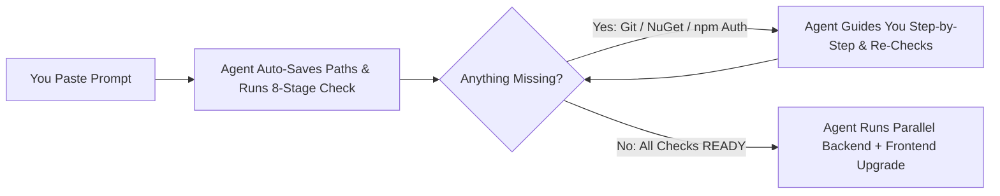

# NGO Core Upgrade

Upgrade a client's **NGO.Core (.NET backend)** and **Angular frontend** through VS Code GitHub Copilot Chat. **You do not need to manually configure files or run setup scripts first**—the agent automatically checks your environment, saves your paths, guides you through any missing login, and runs the upgrade once everything is ready.

---

## 🚀 Quick Start (Just Paste the Prompt)

### 1. Open VS Code & Select the Agent
1. Open this repository in VS Code (or open [`ngo-core-upgrade.code-workspace`](ngo-core-upgrade.code-workspace)).
2. Open **Copilot Chat**, click the agent dropdown next to the **`+`** icon, and select **`ngo-core-upgrade-orchestrator`**.

### 2. Paste Your Upgrade Prompt
Copy and paste this prompt into Copilot Chat (replace the paths and version with yours):

```text
Upgrade my client project to NGO Core 9.4.1:
- Core path: C:\repos\ngo-online-core
- Client path: C:\repos\ngo-online-shelterbox
- Target version: 9.4.1
```

### 3. Let the Agent Guide & Run Everything Automatically
When you send that prompt, **`ngo-core-upgrade-orchestrator`** automatically runs a preflight phase **before** touching any client code:



1. **Auto-Saves Your Paths:** Saves your `Core path` and `Client path` workspace root into [`platform/config/settings.json`](platform/config/settings.json) automatically (`--save-settings`).
2. **Checks Your Environment (8 Stages):** Checks `.NET SDK`, `Node/npm`, `git` identity, `gh` login, Core `releases/*` branches & published package versions (Git tags are not required), NuGet/Azure Artifacts feed auth, and `.npmrc` auth.
3. **Guides You If Anything Is Missing:**
   - Outdated remote `releases/*` branches in Core? The agent fetches them (`git fetch --all`) automatically (Core stays strictly read-only; no branch switching).
   - Missing Git name/email, GitHub login, NuGet token (`401`), or `.npmrc` auth? The agent tells you the exact one-line login command to run and re-checks automatically.
4. **Runs the Upgrade Once Ready:** As soon as all checks pass (`READY TO UPGRADE`), the agent immediately runs the Backend (`.NET`) and Frontend (`Angular`) upgrades in parallel and verifies **0 build errors** on both tracks.

---

## 💬 More Copy-Paste Prompt Samples

Select **`ngo-core-upgrade-orchestrator`** and use any of these prompts:

| What You Want to Do | Copy-Paste Prompt |
| --- | --- |
| **Full Upgrade to Specific Version** | `Upgrade my client project to NGO Core 9.4.1:`<br>`- Core path: C:\repos\ngo-online-core`<br>`- Client path: C:\repos\ngo-online-shelterbox`<br>`- Target version: 9.4.1` |
| **Upgrade to Latest Release on a Branch (e.g. `9.4.x`)** | `Upgrade my client project to the latest 9.4 release:`<br>`- Core path: C:\repos\ngo-online-core`<br>`- Client path: C:\repos\ngo-online-shelterbox`<br>`- Target version: 9.4` |
| **Backend Only (`.NET / NuGet`)** | `Upgrade only the backend NGO.Core packages:`<br>`- Core path: C:\repos\ngo-online-core`<br>`- Client path: C:\repos\ngo-online-shelterbox`<br>`- Target version: 9.4.1` |
| **Frontend Only (`Angular / npm`)** | `Align only the frontend with NGO Core 9.4.1:`<br>`- Core path: C:\repos\ngo-online-core`<br>`- Client path: C:\repos\ngo-online-shelterbox`<br>`- Target version: 9.4.1` |
| **Check & Set Up My Machine Only (Dry-Run)** | `Check my environment and guide me through any missing setup for:`<br>`- Core path: C:\repos\ngo-online-core`<br>`- Client path: C:\repos\ngo-online-shelterbox`<br>`- Target version: 9.4.1` |
| **Resume a Saved Run** | `Resume the upgrade for ngo-online-shelterbox using its saved run state.` |

> **Which Agent Should I Pick in the Dropdown?**
> - ✅ **`ngo-core-upgrade-orchestrator`** *(Default — Always pick this)*: Handles full-stack upgrades, single-track upgrades, preflight setup, and coordination.
> - **`ngo-core-backend-upgrade`** / **`ngo-core-frontend-upgrade`**: Internal domain executors (only select directly if debugging a single track manually).

---

## 🌐 Alternative: Local Web UI Dashboard

If you prefer a browser UI instead of Copilot Chat:
```powershell
node platform/start.js
```
Open **`http://127.0.0.1:3800/`** to pick your client repository, run the visual preflight & impact preview, monitor live upgrade progress, and approve commits. See [platform/README.md](platform/README.md).

---

## 📖 Reference Details (Optional Reading)

You do **not** need to read the sections below to run an upgrade—the agent handles them automatically. Use these for reference or manual troubleshooting.

<details>
<summary><strong>📍 Where Paths & Config Are Stored</strong></summary>

| File / Setting | Purpose |
| --- | --- |
| **[`platform/config/settings.json`](platform/config/settings.json)** | Automatically updated when the agent runs `check-environment.js --save-settings`. Stores `"corePath"` and `"approvedWorkspaceRoots"`. |
| **[`ngo-core-upgrade.code-workspace`](ngo-core-upgrade.code-workspace)** | Optional VS Code multi-root workspace template. Edit `"folders"` if you want both the Agent repo and Client repo open in the same VS Code Explorer sidebar. |
| **`NGO_CORE_PATH` / `NGO_WORKSPACE_ROOTS`** | Optional Windows User environment variables if you want machine-wide defaults across multiple clones. |
| **`%APPDATA%\NuGet\NuGet.Config` & `<client>\ngo-api\NuGet.Config`** | NuGet package feeds and `<packageSourceMapping>` rules. |
| **`%USERPROFILE%\.npmrc` & `<client>\ngo-client\.npmrc`** | Project `.npmrc` defines scoped registries (`@ngo:registry=...`); user `%USERPROFILE%\.npmrc` holds your personal auth tokens. |

</details>

<details>
<summary><strong>🛠️ Manual Commands the Agent Uses During Guided Setup</strong></summary>

If the agent detects something missing on a brand-new machine, it will run or guide you through the relevant command below:

1. **Required Runtimes (`winget`):**
   - Git: `winget install --id Git.Git -e --source winget`
   - Node.js LTS: `winget install OpenJS.NodeJS.LTS`
   - GitHub CLI: `winget install --id GitHub.cli -e --source winget`
   - .NET SDK: `winget install Microsoft.DotNet.SDK.8`
2. **Git Identity & GitHub Login:**
   ```powershell
   git config --global user.name "Your Full Name"
   git config --global user.email "your.email@organization.com"
   gh auth login --hostname github.com --web
   gh auth setup-git --hostname github.com
   ```
3. **Fetch Remote `releases/*` Branches in `ngo-online-core` (Read-Only):**
   ```powershell
   git -C "<path-to-ngo-online-core>" fetch --all
   ```
4. **NuGet / Azure Artifacts Interactive Login (`.NET` Backend):**
   ```powershell
   # Install Credential Provider (if not installed with Visual Studio)
   iex "& { $(irm https://aka.ms/install-artifacts-credprovider.ps1) } -AddNetfx"

   # Authenticate interactively once inside the client backend folder
   cd "<client-path>\ngo-api"
   dotnet restore --interactive
   ```
5. **Private npm Feed Login (`Angular` Frontend):**
   ```powershell
   cd "<client-path>\ngo-client"
   npx vsts-npm-auth -config .npmrc
   ```

</details>

<details>
<summary><strong>🔍 Manual Preflight CLI Reference (<code>node tools/check-environment.js</code>)</strong></summary>

The agent runs this automatically, or you can run it manually from the repository root:

```powershell
node tools/check-environment.js `
  --core-path "C:\repos\ngo-online-core" `
  --client-path "C:\repos\ngo-online-shelterbox" `
  --target 9.4.1 `
  --tracks backend,frontend `
  --save-settings
```

**What the 8 Stages Verify:**
1. **Stage 1 — Runtime & Tool Availability:** `git`, `node`, `gh`, `dotnet` (matching `<TargetFramework>`), `dotnet-ef`, `az`, and `npm` (scoped to active tracks).
2. **Stage 2 — Git Identity & GitHub Access:** `git config user.name` / `user.email`, `gh auth status`, `credential.helper`, and `git ls-remote`.
3. **Stage 3 — Local NGO Core Discovery & Validation:** Verifies Core `.git` root boundaries, remote URL, and project structure (`ngo-api-core/`, `ngo-client-core/`), and rejects client repositories.
4. **Stage 4 — NuGet & Azure Artifacts 5-Stage Check:** Separates (1) `NuGet.Config` & `<packageSourceMapping>` validity, (2) Credential Provider discovery, (3) auth token acquisition, (4) private feed HTTP probe (`200` vs `401` vs `403`), and (5) target package version availability.
5. **Stage 5 — npm & `.npmrc` Configuration:** Inspects project and user `.npmrc` (with secrets redacted), checks private registries for valid credentials, and selects `npm ci --legacy-peer-deps` vs `npm install --legacy-peer-deps`.
6. **Stage 6 — Target Client Project & Working Tree Safety:** Detects installed backend (`.csproj`) and frontend (`package.json`) Core versions and checks `git status --porcelain`.
7. **Stage 7 — Release Resolution Preconditions:** Verifies source and target release versions via published NuGet/npm package metadata and `origin/releases/*` branches / commit history (Git tags are optional and not required).
8. **Stage 8 — Readiness Verdict & State Fingerprint:** Outputs `READY TO UPGRADE` (or `BLOCKED` with exact fix commands).

</details>

<details>
<summary><strong>🔧 Troubleshooting Common Error Codes</strong></summary>

| Error / Status | Cause | Exact Fix |
| --- | --- | --- |
| `GH_AUTH_OK_BUT_GIT_CREDENTIAL_MISSING` | `gh auth status` is logged in, but Git's `credential.helper` is not linked. | Run: `gh auth setup-git --hostname github.com` |
| `SSH_AUTH_FAILED` | Repository `origin` uses `git@github.com:...` (SSH), and `gh auth login` over HTTPS does not configure SSH keys. | Load your SSH key (`ssh-add`) or upload it via `gh ssh-key add`, or use HTTPS with `gh auth setup-git`. |
| `MULTIPLE_CANDIDATES_FOUND` | More than one valid `ngo-online-core` folder exists under your workspace roots. | Pass `--core-path "<chosen-path>"` explicitly or set `NGO_CORE_PATH`. |
| `SOURCE_MAPPING_BLOCKED` | `NuGet.Config` has `<packageSourceMapping>` without an `NGO.*` pattern. | Add `<packageSource key="<YourNGOFeed>"><package pattern="NGO.*" /></packageSource>` to `NuGet.Config`. |
| `UNAUTHENTICATED` (`HTTP 401` on NuGet) | Missing or expired Azure Artifacts token. | Run `dotnet restore --interactive` inside `<client>\ngo-api\` or run `az login`. |
| `FORBIDDEN` (`HTTP 403` on NuGet) | Logged-in Azure account lacks Reader permission on the feed. | Request **Feed Reader** access in Azure DevOps -> Artifacts -> Feed Settings -> Permissions (do not retry login). |
| `NPM_AUTH_REQUIRED` / `INCOMPLETE_VSS_OR_BASIC_AUTH` | `<client>\ngo-client\.npmrc` has a private registry or `username=VssSessionToken` without a token in `%USERPROFILE%\.npmrc`. | Run `npx vsts-npm-auth -config .npmrc` inside `<client>\ngo-client\` or add your token to `%USERPROFILE%\.npmrc`. |
| `MISSING_ENV_VAR_IN_NPMRC` | `.npmrc` references `${VAR_NAME}`, which is not defined in the current shell environment. | Set `$env:VAR_NAME = "<token>"` in your user environment before running `npm`. |

</details>

<details>
<summary><strong>📋 Where Upgrade Reports & Outputs Go</strong></summary>

| Output | Location |
| --- | --- |
| Combined report and deployment handover | `orchestrator/runs/<client>/<run-id>/` |
| Backend state, checkpoints, and evidence | `backend/runs/<client>/<run-id>/` |
| Frontend state, checkpoints, and evidence | `frontend/runs/<client>/<run-id>/` |
| Reusable Core candidate facts | `ingest/knowledge/candidates/releases/` |
| Shared `core-change-set.json` & `upgrade-context.json` | `orchestrator/runs/<client>/<run-id>/` |

</details>

<details>
<summary><strong>📦 Package or Install on Another Machine</strong></summary>

**Create a clean, portable `.zip` archive to share with coworkers:**
```powershell
.\package-agent.ps1 -OutputPath ".\dist"
```
`package-agent.ps1` strips machine-specific paths (`D:\NGO Client`), local run histories, and credential files so the zip is clean for any coworker's machine. See [IMPORT.md](IMPORT.md).

**Install skills into VS Code user profile:**
```powershell
.\install.ps1 -InstallDir "C:\repos\NGO-Core-Upgrade" -SkillsOnly
```

</details>

<a id="tests--validation"></a>

<details>
<summary><strong>🧪 Framework Validation & Architecture Docs</strong></summary>

Run all **20 validation suites** from this repository's root:
```powershell
node tools/validate-all.js
```

**Architecture & Contracts:**
- [AGENTS.md](AGENTS.md) — Routing, multi-machine protocol, and safety contract
- [engine/AGENTS.md](engine/AGENTS.md) — Shared engine lifecycle and contracts
- [ingest/README.md](ingest/README.md) — Shared release ingestion
- [orchestrator/README.md](orchestrator/README.md) — Shared-run coordination
- [backend/README.md](backend/README.md) — Backend executor workflow
- [frontend/README.md](frontend/README.md) — Frontend executor workflow
- [platform/README.md](platform/README.md) — Local Web UI platform

</details>
